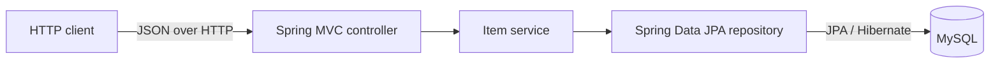

# Backend architecture

## Scope

This project is a Java Spring Boot REST API. It currently provides an item creation endpoint backed by MySQL.

## Technology flow

## Responsibilities

- **Controller:** exposes `POST /api/items`, validates the request, and returns the HTTP response.
- **Service:** checks whether an item name already exists, saves valid items, and maps them to response DTOs.
- **Repository:** uses Spring Data JPA to query and save `Item` records.
- **MySQL:** stores item data beyond the lifetime of the application process.
- **DTOs:** define the JSON request and response shapes independently of the persistence entity.

## Create item flow

1. The client sends an item name and optional description as JSON.
2. Jakarta Bean Validation rejects a blank name.
3. The service checks for an existing name, ignoring case and surrounding spaces.
4. If the name exists, the API returns `409 Conflict` with code `ITEM_ALREADY_EXISTS` and a readable message.
5. Otherwise, Spring Data JPA saves the item in MySQL and the API returns `201 Created`.

## Configuration

The MySQL URL, username, and password are read from `DB_URL`, `DB_USERNAME`, and `DB_PASSWORD`. Local defaults are provided in `application.properties`; use environment-specific credentials outside local development. Hibernate schema auto-update is enabled for this starter project. A production deployment should use a managed schema migration process before it is exposed to users.
