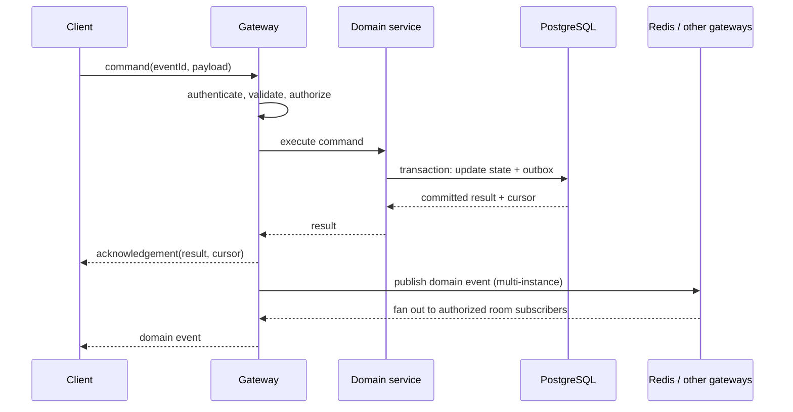

# Real-time application architecture

## Scope and assumptions

This is a domain-neutral starter for a browser application with authenticated users, shared live state, and transient presence signals. It assumes moderate initial traffic and one deployable API. Product-specific entities and permissions remain to be defined.

## Logical view

```mermaid
flowchart LR
  Browser[React browser app] -->|HTTPS REST| API[Node API]
  Browser <-->|WSS Socket.IO| Gateway[Realtime gateway]
  Gateway --- API
  API --> DB[(PostgreSQL)]
  Gateway --> DB
  API -. multi-instance fan-out .-> Redis[(Redis)]
  Gateway -. Socket.IO adapter .-> Redis
```

The API and gateway can live in one process and share domain services. Keep transport handlers thin: parse and validate input, authenticate/authorize, call a domain operation, then publish the resulting event.

## Responsibilities

### Browser

- Render UI from a local state store and server snapshots.
- Use REST for initial loads, pagination, and ordinary resource queries.
- Use sockets for commands that need immediate feedback and server-pushed updates.
- Track connection state; reconnect with exponential backoff and jitter.
- On reconnect, request a snapshot or replay using the last acknowledged cursor. Never assume the connection delivered every event.
- Avoid optimistic state that cannot be reconciled; mark pending commands and replace them with the server response.

### API and realtime gateway

- Verify identity at the socket handshake; derive the user ID from the verified session/token, never from a client-supplied identity field.
- Validate schemas and enforce authorization on every command and room subscription.
- Apply rate limits, message-size limits, origin checks, and connection limits.
- Persist domain mutations in PostgreSQL transactions before acknowledging success.
- Return a stable command acknowledgement containing success or a typed error and the resulting event/cursor.
- Use rooms scoped by authorized domain resources; never allow arbitrary room names from clients.

### PostgreSQL

- Own durable domain state, memberships, and (if replay is required) an append-only event/outbox table.
- Use transactions for state changes and outbox insertion together.
- Add indexes for resource membership, timeline ordering, and cursor-based retrieval.

### Redis

- Optional for a single API instance. Add the Socket.IO Redis adapter when multiple instances must broadcast to one another.
- Use TTL-backed keys for transient presence, typing indicators, and distributed rate-limit counters where needed.
- Do not make Redis the only copy of durable business state.

## Event flow



For a first version, the domain service can emit after commit. If losing an event between database commit and broadcast is unacceptable, use a transactional outbox: a worker reads unprocessed outbox rows, publishes them, then marks them delivered. Consumers should handle duplicate delivery idempotently.

## Contract conventions

- Name client commands `resource:action` and server events `resource:changed` (for example `task:update` and `task:updated`).
- Version payloads or maintain compatibility during rolling deploys.
- Include `eventId`, `occurredAt`, resource ID, and monotonic cursor/sequence where ordering or replay matters.
- Acknowledge commands with `{ ok: true, data, cursor }` or `{ ok: false, error: { code, message } }`.
- Do not broadcast secrets or fields the subscribing user is not authorized to see.
- Define shared schemas/contracts in `packages/contracts`; validate them at runtime in both transports.

## Reliability and ordering

WebSocket is an online delivery channel, not a durable queue. Use database snapshots and cursors for recovery. Define whether ordering is global or per resource; per-resource sequence numbers are usually sufficient and cheaper. Clients should ignore duplicates and detect cursor gaps, then resynchronize. Commands should be retry-safe using an idempotency key when the client may retry after a timeout.

## Security and operations

- TLS for all production HTTP and WebSocket traffic.
- Short-lived credentials; validate origin and allowed hosts; do not put long-lived secrets in browser storage.
- Limit payload size, event frequency, concurrent connections, and room subscription count.
- Redact credentials and personal data from logs. Record connection count, event rate, acknowledgement latency, errors, reconnects, and outbox lag.
- Health endpoints: liveness (process is alive) and readiness (required dependencies are usable).
- Graceful shutdown: stop accepting connections, notify/drain clients, finish in-flight writes, then close database and Redis clients.

## Deployment shape

Start with static web hosting/CDN, one API service, managed PostgreSQL, and optional managed Redis. Configure the load balancer for WebSocket upgrades and suitable idle timeouts. If long-lived connections require sticky sessions, configure them explicitly; the Redis adapter handles cross-instance broadcast but does not itself guarantee session affinity for polling transports. Add API replicas only after measuring connection count and event throughput.

## Decisions to confirm for a real product

1. Domain resources and who may read or mutate each one.
2. Login/session provider and token lifecycle.
3. Whether missed updates need replay, and for how long.
4. Expected concurrent connections, geography, and latency target.
5. Retention, deletion, audit, and privacy requirements.
6. Hosting platform and its WebSocket/load-balancer behavior.

